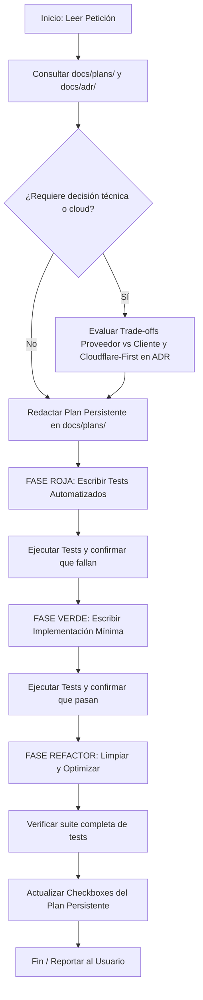

# Directrices del Sistema para Agentes de IA (AGENTS.md)

Este documento define las reglas de comportamiento, metodologías de ingeniería y protocolos obligatorios para cualquier agente de IA o desarrollador que trabaje en este repositorio.

---

## 1. Visión y Foco Comercial del Proyecto

Este repositorio contiene la implementación de un **asistente personal con IA y cerebro domótico comercial**. Se construye **sobre Home Assistant** (ADR-0003) y se distribuye como **app de HA** en equipos Linux ARM64/x86 (Raspberry Pi 5 o mini PC con HA OS):
- **Core Orquestador (`edge-core`)**: Escrito en **Go 1.27+**, compilado como binario estático (`CGO_ENABLED=0`). Responsable de:
  - el cliente de la WebSocket API de HA (ADR-0005) y la normalización de entidades;
  - el AI Harness: loop del agente, tools, guardrails, cliente MCP y LLM vía `llmkit` con formatos OpenAI y Anthropic;
  - la memoria, el scheduler y la identidad del hogar;
  - la persistencia en SQLite WAL (ADR-0006);
  - el cliente del relay y la UI de ingress.
- **Integración de HA (`ha-integration`)**: Escrita en **Python 3.13+** y gestionada con **`uv`**. Es una custom integration mínima que registra nuestro agente como `ConversationEntity` para el pipeline de voz Assist.
- **Nube delgada**: Escrita en **TypeScript sobre Cloudflare Workers** (ADR-0004). Incluye:
  - cuentas y pairing;
  - el relay con Durable Objects;
  - el gateway de LLM sobre AI Gateway;
  - los servidores MCP (calendario, transporte);
  - la ingesta del GTFS, en un Container Go.
- **Referencia Arquitectónica Principal**: Consultar siempre [docs/arquitectura.md](docs/arquitectura.md) antes de proponer cambios estructurales. [arquitectura_teórica.md](arquitectura_teórica.md) es un documento histórico.

### Principio de Foco Comercial y Estrategia de Negocio
Este software es el núcleo de un **producto comercial**. Cada línea de código y cada decisión técnica impacta directamente la viabilidad económica del negocio y la retención del cliente:
1. **Minimización de OPEX**: Reducir drásticamente los costos operativos recurrentes de infraestructura en la nube por cada hub desplegado.
2. **Autonomía Edge-First**: El cliente debe disfrutar de máxima privacidad y funcionalidad local incluso ante caídas de internet, reduciendo nuestro costo de soporte y tráfico en la nube.
3. **Calidad Premium y Confiabilidad**: Evitar fallos silenciosos o cuelgues que demanden soporte técnico en campo o dañen la reputación de la marca.

---

## 2. Los Mandatos Obligatorios

Cualquier intervención en este repositorio debe respetar de forma estricta los siguientes mandatos:

### Mandato I: Desarrollo Dirigido por Pruebas (Strict TDD)
> **"PRIMERO SE CONSTRUYEN LOS TESTS, LUEGO EL CÓDIGO"**

No se permite escribir una sola línea de código de producción sin haber escrito y ejecutado previamente un test automatizado que falle por la razón adecuada.

#### Ciclo Red-Green-Refactor Obligatorio:
1. **Rojo (Red)**:
   - Diseñar la interfaz/firma de la función, struct o módulo.
   - Escribir la prueba unitaria o de integración describiendo el comportamiento esperado, casos borde y manejo de errores.
   - Ejecutar la suite de pruebas y **confirmar que el test falla**.
2. **Verde (Green)**:
   - Escribir únicamente el código mínimo necesario para que el test pase exitosamente.
   - Ejecutar la prueba y verificar que pasa.
3. **Refactorizar (Refactor)**:
   - Mejorar legibilidad, eliminar duplicación, optimizar rendimiento o modularidad.
   - Re-ejecutar toda la suite de pruebas para asegurar cero regresiones.

#### Reglas de Testing por Lenguaje:
- **Go (`edge-core`)**:
  - Utilizar el paquete estándar `testing`.
  - Diseñar con **Table-Driven Tests** (`tt` pattern) para cubrir casos válidos, inválidos y límites.
  - Favorecer interfaces pequeñas para facilitar inyección de dependencias y mocks.
  - Ejecución de validación: `go test -v -race ./...`
    - En el monorepo, usar `dev/scripts/test.ps1`, que recorre todos los módulos de `go.work`.
  - **Race detector**:
    - Requiere `CGO_ENABLED=1` y gcc. En Windows se usa MinGW-w64 (WinLibs).
    - CGO se habilita **solo para tests**. Los binarios de producción se compilan con `CGO_ENABLED=0`.
  - **Integration tests**:
    - Llevan el build tag `integration`.
    - Corren contra el HA de `dev/docker-compose.yml`.
- **Python (`ha-integration`)**:
  - Utilizar `pytest`, `pytest-asyncio` y `pytest-homeassistant-custom-component`.
  - Aislar las llamadas a `edge-core` (`convapi`) con mocks.
  - Gestión de ejecución mediante `uv`: `uv run pytest`
- **TypeScript (`cloud/`)**:
  - Utilizar **Vitest** con `@cloudflare/vitest-pool-workers`, de modo que los tests corran dentro de workerd con DO, D1 y KV locales.
  - Ejecución: `npm test`.

---

### Mandato II: Registro de Decisiones (ADR) con Evidencia de Trade-Offs Duales
> **"TODA DECISIÓN ARQUITECTÓNICA DEBE EVIDENCIAR EL IMPACTO PARA EL PROVEEDOR Y PARA EL CLIENTE"**

Cualquier cambio, elección técnica, descarte o definición estructural relevante debe registrarse formalmente como un **Architecture Decision Record (ADR)** en `docs/adr/`.

#### Evaluación Dual Obligatoria en cada ADR:
Toda propuesta arquitectónica debe analizar explícitamente:
- **Trade-off para Nosotros como Proveedores**:
  - Impacto en OPEX (costo en la nube, ancho de banda, almacenamiento, licencias).
  - Complejidad operativa, mantenibilidad del código y carga de soporte al cliente.
  - Velocidad de desarrollo e iteración comercial.
- **Trade-off para el Cliente Final**:
  - Experiencia de usuario (latencia, tiempo de respuesta de comandos de domótica).
  - Privacidad de datos (procesamiento local vs envío de telemetría a la nube).
  - Resiliencia y continuidad operativa (funcionamiento sin conexión a internet).
  - Costo total de adquisición y consumo eléctrico del dispositivo.

#### ¿Cuándo es obligatorio redactar un ADR?
- Selección, sustitución o eliminación de librerías/dependencias principales.
- Modificaciones en los protocolos edge↔HA, edge↔nube (relay) o edge↔integración de HA.
- Cambio de proveedor de LLM, de formato de wire o de la estrategia del gateway de LLM.
- Cambios en el esquema de la base de datos SQLite o políticas de migración.
- Definición de contratos de normalización de entidades o esquemas de tools MCP.
- Decisiones de seguridad, encriptación de secretos o tokens.
- Introducción de cualquier servicio cloud o cambio de proveedor.

---

### Mandato III: Arquitectura Cloud Basada en Cloudflare (Cloudflare-First)
> **"TODA NECESIDAD CLOUD DEBE PRIORIZAR EL ECOSISTEMA CLOUDFLARE POR COSTO/CALIDAD"**

La infraestructura satélite en la nube estará cimentada sobre **Cloudflare**:
1. **Prioridad Absoluta de Servicios Cloudflare**:
   - **Almacenamiento de Objetos / Buckets**: Priorizar **Cloudflare R2** (cero costos de egress / transferencia saliente).
   - **Colas y Mensajería Asíncrona**: Priorizar **Cloudflare Queues**.
   - **Cómputo Edge / Serverless**: Priorizar **Cloudflare Workers**. Para cargas que no caben en un Worker, como la ingesta del GTFS, usar **Cloudflare Containers**.
   - **Estado por hogar y conexiones persistentes**: Priorizar **Durable Objects**, con SQLite y **WebSocket Hibernation**.
   - **Base de Datos / Almacén Clave-Valor**: Priorizar **Cloudflare D1** y **Workers KV**.
   - **Gateway de LLM y métricas**: Priorizar **AI Gateway** (BYOK) y **Analytics Engine**.
   - **Conectividad nube↔hogar**: Usar el **relay con Durable Objects** (ADR-0004): el hogar abre un WebSocket saliente y no hay que abrir puertos en el router del usuario. Los **Cloudflare Tunnels** quedan solo para casos puntuales, porque Cloudflare limita a 1.000 túneles por cuenta.
2. **Justificación por Costo/Calidad**:
   - Si en algún caso extremo se requiere evaluar otro proveedor cloud (AWS, GCP, Azure), el ADR debe demostrar de forma cuantitativa y concluyente por qué la solución de Cloudflare no satisface el requerimiento técnico o comercial.

---

### Mandato IV: Persistencia y Memoria de Planes
> **"TODOS LOS PLANES DEBEN PERSISTIRSE PARA SER CONSULTABLES COMO MEMORIA"**

Las sesiones de chat y contextos de IA son volátiles; el repositorio es la única fuente de verdad persistente. Los planes de trabajo jamás deben quedar únicamente en el diálogo.

#### Ciclo de Vida de los Planes (`docs/plans/`):
1. **Creación**: Antes de iniciar una tarea compleja, refactor o feature, se debe crear un archivo en `docs/plans/YYYY-MM-DD_<nombre_tarea>.md` utilizando la plantilla en [docs/plans/template.md](docs/plans/template.md).
2. **Definición de Pruebas Primero**: El plan debe detallar explícitamente qué tests se van a crear antes de comenzar a codificar.
3. **Seguimiento con Checkboxes**: Cada subtarea debe representarse como `- [ ]` y marcarse `- [x]` inmediatamente al ser completada y testeada.
4. **Memoria de Estado**: Si una tarea queda incompleta o pausada, el archivo debe reflejar el estado exacto, obstáculos encontrados y los siguientes pasos para que cualquier agente posterior retome el hilo sin pérdida de contexto.
5. **Índice Central**: Registrar el plan en el historial de [docs/plans/README.md](docs/plans/README.md).

---

## 3. Protocolo de Trabajo del Agente (Paso a Paso)

Cada vez que el usuario solicite una nueva funcionalidad, corrección o cambio:

1. **Recuperación de Memoria**: Leer `docs/plans/` y `docs/adr/` relevantes para entender el estado actual y precedentes.
2. **Documentación Previa**:
   - Si la tarea involucra decisiones técnicas o servicios cloud, redactar el ADR analizando trade-offs para el proveedor y el cliente.
   - Redactar o actualizar el plan de trabajo en `docs/plans/`.
3. **Ejecución TDD**:
   - Escribir tests -> Verificar fallo -> Implementar código -> Verificar éxito -> Refactorizar.
4. **Actualización de Memoria**:
   - Actualizar el plan con el estado de avance y notas de implementación.

---

## 4. Estándares de Código y Calidad

### Go (`edge-core`)
- Manejo explícito de errores (`if err != nil`). Prohibido descartar errores con `_` sin justificación documentada.
- No utilizar `panic()` en tiempo de ejecución de producción; todos los errores deben propagarse o recuperarse en el supervisor.
- Respetar concurrencia segura: uso adecuado de `sync.Mutex`, `sync.RWMutex`, canales y `context.Context` para cancelación.
- Mantener compilación limpia sin advertencias de linter (`golangci-lint` o `go vet`).
- Normalización obligatoria: toda entidad de HA debe transformarse a la **Entidad Normalizada v1** y sus acciones a **Capabilities**, según `contracts/schemas/entity.v1.json` y la §7.1 de `docs/arquitectura.md`.

### Python (`ha-integration`)
- Uso obligatorio de **type hints** (`typing`) en todas las funciones y clases.
- Programación asíncrona no bloqueante con `asyncio`. Nada debe bloquear el event loop de HA.
- Dependencias gestionadas exclusivamente con `uv` y especificadas en `pyproject.toml`.

### TypeScript (`cloud/`)
- `strict: true`. Está prohibido usar `any` sin una justificación documentada.
- Versiones **exactas** (sin `^` ni `~`) para `agents`, `wrangler` y los SDKs de Cloudflare, porque cambian muy rápido.
- Durable Objects con WebSockets: usar siempre `ctx.acceptWebSocket()` (Hibernation) y nunca `ws.accept()`.

---

## 5. Control de Cambios y Git
- Commits descriptivos siguiendo la convención de conventional commits:
  - `test(...)`: incorporación de pruebas antes de código.
  - `feat(...)`: nueva funcionalidad.
  - `fix(...)`: corrección de bug con su respectivo test de regresión.
  - `docs(...)`: actualización de ADRs, planes o documentación.
  - `refactor(...)`: mejoras de código sin cambio de comportamiento.
